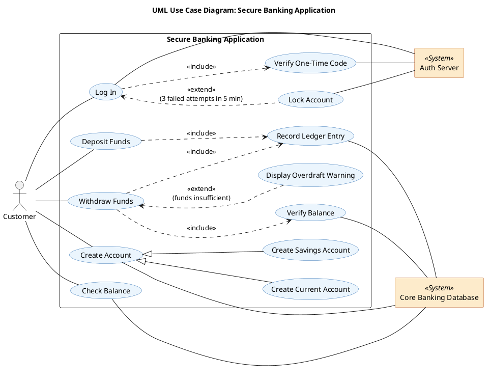

# Software Requirements Specification (SRS)

**Project:** Secure Banking Application | **Course:** SCMP 401 Software Engineering Studio

| | |
|---|---|
| **Team Name** | Team Delta |
| **Date and Version** | 2026-11-11, Version 1.0 (Draft for Milestone 1 Review) |
| **Document Authors** | Mina (Product Owner), Rozyar (System Architect) |
| **Course and Instructor** | SCMP 401 Software Engineering Studio, Dr. Bestoon Hussien |
| **Document Standard** | Adapted from IEEE 830-1998 and Ian Sommerville Chapter 4 |

## Document Preface and Revision History

<!-- Owner: Aiman -->

| Version | Date | Description of Changes | Author(s) | Approved By |
|---|---|---|---|---|
| v0.1 | 2026-11-11 | Document skeleton | Aiman | |

## 1. Introduction and System Vision

<!-- Owner: Mina. Issue #8 -->

### 1.1 Purpose of the System

This Software Requirements Specification (SRS) defines the user requirements, system requirements and non-functional requirements of the **Secure Banking Application**, a web-based system that lets bank customers manage their money online.

The system shall give authenticated customers secure digital access to their accounts so they can open Current or Savings Accounts, check their balances, and make deposits and withdrawals that are processed atomically and recorded in an immutable audit trail.

This document is the agreement between the stakeholders listed in Section 2: the evaluator uses it to assess the product, developers use it as the blueprint for implementation, and testers use it to derive automated JUnit tests. Every requirement in it is traceable to a use case and a test in Section 7.

### 1.2 Scope and System Boundary

The Secure Banking Application covers the web front end and the application logic used by bank customers. Everything inside the boundary is built by Team Delta. The three actors below lie **outside** the system boundary and interact with it:

| Actor | Type | Role |
|---|---|---|
| Customer | Primary actor | Starts every use case through the web interface. |
| Auth Server | Secondary actor | Verifies credentials and one-time verification codes. |
| Core Banking Database | Secondary actor | Stores customers, accounts and the immutable transaction ledger. |

**In scope** for Milestone 1 (one function per user requirement):

| Function | User requirement |
|---|---|
| Secure log in with password and one-time code (multi-factor authentication), including account lockout after repeated failures | UR-1 |
| Customer self-service creation of Current and Savings Accounts | UR-2 |
| Balance inquiry for the customer's own accounts | UR-3 |
| Atomic deposits | UR-4 |
| Atomic withdrawals, following the rules of each account type | UR-5 |

All money amounts are in US dollars (USD).

**Current Accounts and Savings Accounts.** The system supports two account types with different rules:

| Rule | Current Account | Savings Account |
|---|---|---|
| Purpose | Everyday spending | Saving money and earning interest |
| Overdraft | Allowed down to L_max = $500.00 (lowest balance −$500.00) | Not allowed |
| Interest | None | I = B × (r / 12) on the last calendar day of each month, r = 2.5% |
| Minimum balance | None | B_min = $100.00 |
| Withdrawal allowed when | Balance + 500.00 ≥ A | Balance − A ≥ 100.00 |

Example: a Savings Account whose lowest daily balance in a month is B = $1,200.00 earns I = 1,200.00 × (0.025 / 12) = $2.50 that month.

### 1.3 Out of Scope

The following functions are **not** part of this system for Milestone 1. They are excluded to keep the sprint focused on the five user requirements.

| Excluded function | Reason |
|---|---|
| Account creation by bank staff or tellers, and other back-office administration | Product Owner decision: in Milestone 1, customers create their own accounts. |
| Customer registration and onboarding, including identity checks and registering or changing the mobile number | Customers are assumed to be already registered with the bank and to have a verified mobile number, which SR-1.3 uses to send the one-time code. |
| Transfers between accounts, to other customers or to other banks | Not one of the five user requirements. |
| Bill payments, cheques and card payments | Not one of the five user requirements. |
| Loans, credit cards and credit underwriting | Separate banking products with their own regulation. |
| Physical cash handling: ATM hardware, cash dispensing and vault management | The system records a withdrawal in the ledger; handing over physical cash is outside the software boundary. |
| Foreign currency accounts and currency exchange | All amounts are in USD. |
| Closing accounts and changing interest rates or overdraft limits | Rates and limits are fixed values in this SRS (r = 2.5%, L_max = $500.00, B_min = $100.00). |
| Native mobile applications | The product is a web application. |

### 1.4 Definitions, Acronyms, and Abbreviations

| Term | Meaning |
|---|---|
| A | The amount of a deposit or withdrawal. Always greater than $0.00. |
| AES-256 | Advanced Encryption Standard with a 256-bit key, used to protect stored data. |
| Atomic transaction | A transaction that either completes fully or has no effect at all. |
| B | The lowest daily balance of a Savings Account during a month, used for interest. |
| B_min | The minimum balance a Savings Account must keep: $100.00. |
| BCrypt | A slow, salted password hashing algorithm. This system uses cost factor 12. |
| CI | Continuous Integration: tests run automatically on every pull request (GitHub Actions). |
| Current Account | A transactional account for everyday spending, with an overdraft facility. |
| ERR_INSUFFICIENT_FUNDS | The error the system returns when a withdrawal would break the account's balance rule. |
| IEEE 830 | The IEEE recommended practice for software requirements specifications that this document follows. |
| JUnit | The Java unit testing framework used for the automated tests named in the RTM. |
| L_max | The overdraft limit of a Current Account: $500.00. |
| Ledger | The immutable, append-only record of every transaction. Entries are never edited or deleted. |
| MFA | Multi-Factor Authentication: proving identity with two or more factors, here a password and a one-time code. |
| NFR | Non-Functional Requirement: a quality of the whole system, such as speed, security or availability. |
| OTP | One-Time Password (one-time verification code): a short code valid for a single login. |
| r | The annual interest rate of a Savings Account: 2.5%. |
| Rollback | Undoing every change of a failed transaction, so the data returns to its state before the transaction. |
| RTM | Requirements Traceability Matrix: the table linking each user requirement to system requirements, use cases and tests. |
| Savings Account | An interest-bearing account with a minimum balance and no overdraft. |
| SR | System Requirement: a detailed technical requirement with inputs, outputs, preconditions, postconditions and exceptions. |
| SRS | Software Requirements Specification: this document. |
| TLS 1.3 | Transport Layer Security version 1.3, used to encrypt all traffic between browser and server. |
| UC | Use Case: a goal an actor reaches by interacting with the system, shown in the UML diagram. |
| UR | User Requirement: a requirement written in natural language from the customer's point of view. |

## 2. Stakeholders and Reader Perspectives

<!-- Owner: Mina. Issue #8 -->

Different stakeholders read this SRS for different purposes:

| Reader category | Stakeholders | What they need from this document | Main sections |
|---|---|---|---|
| Client and evaluator | Course instructor (Dr. Bestoon Hussien) | Confirm that the system meets the educational and business objectives of the milestone. | 1, 7 |
| End users | Bank customers | Confirm that the services they need are described correctly. | 1, 3 |
| Product Owner | Mina | Keep scope, priorities and acceptance criteria consistent with the backlog. | 1, 2, 3 |
| ScrumMaster | Aiman | Plan the sprint, manage change control and maintain traceability. | 7 |
| System architect and security lead | Rozyar | Design authentication, security controls and the UML model. | 4.1, 5.1, 6 |
| Software developers | Rozi, Sahand, Ara | Use the system requirements as the blueprint for back end, database and front end. | 4, 6 |
| Test engineers | Quality assurance and the automated JUnit suite | Derive test cases from requirements and acceptance criteria. | 4, 5, 7 |
| Security and compliance auditors | Bank auditors (external) | Check encryption, password storage and the immutable audit trail. | 5.1, 5.4 |

## 3. User Requirements Definition

<!-- Owner: Ara. Issue #9 -->

### UR-1 Security and Authentication

### UR-2 Account Creation

### UR-3 Balance Inquiry

### UR-4 Deposit

### UR-5 Withdrawal

## 4. Detailed System Requirements Specification

### 4.1 Authentication and Access Control

<!-- Owner: Rozyar. Issue #10. SR-1.1, SR-1.2, SR-1.3 -->

Authentication is handled by the Auth Server, which stores the credential records and verifies passwords and one-time verification codes. A customer reaches account services only after passing SR-1.1 and then SR-1.3, and only while SR-1.2 has not locked the account.

**SR-1.1 [User ID and Password Verification]:** Upon user login, the system shall prompt for User ID and Password. Passwords shall be hashed using BCrypt with cost factor 12; only the hash shall be stored and compared, and the plain-text password shall never be stored or logged.

| Field | Specification |
|---|---|
| Inputs | User ID and Password, sent over TLS 1.3. |
| Processing | The Auth Server loads the stored BCrypt hash for the User ID and checks the entered password against it with BCrypt (cost factor 12). |
| Outputs | Success: the customer is passed to the one-time code step (SR-1.3). Failure: the message "Invalid User ID or password". |
| Preconditions | The customer is registered; the account is not locked (SR-1.2); the connection uses TLS 1.3. |
| Postconditions | Success: a pending login is created that grants no account service until SR-1.3 completes, and the failed-attempt counter is reset to 0. Failure: the failed-attempt counter for the User ID increases by 1. |
| Exceptions | Unknown User ID or wrong password: the same generic message is returned in both cases, so the response does not reveal which User IDs exist. Auth Server unavailable: login is refused with "Service temporarily unavailable" and no session is created. |

**SR-1.2 [Account Lockout]:** If three (3) consecutive incorrect password attempts are detected for the same User ID within 5 minutes, the system shall lock the account for 15 minutes and write a security audit log entry.

| Field | Specification |
|---|---|
| Inputs | Failed password attempts from SR-1.1, each with the User ID and the time of the attempt. |
| Processing | The Auth Server counts consecutive failed attempts per User ID. When the 3rd failure occurs within 5 minutes of the 1st, the account is locked until the time of the 3rd failure + 15 minutes. |
| Outputs | The message "Account locked. Try again in 15 minutes". |
| Preconditions | The User ID exists and the account is not already locked. |
| Postconditions | Account status = LOCKED with an unlock time; a security audit log entry is appended with timestamp, User ID and event type ACCOUNT_LOCKED (audit log rules in Section 5.4). After 15 minutes the account unlocks automatically and the counter resets to 0. |
| Exceptions | Login attempt while locked: rejected with the same lock message, even if the password is correct, and the lock time is not extended. A successful login before the 3rd failure resets the counter to 0. Failures older than 5 minutes no longer count towards the lock. |

**SR-1.3 [One-Time Verification Code]:** After a correct password (SR-1.1), the system shall require a one-time verification code before any account service is shown. The code shall be 6 digits, valid for 5 minutes, and usable only once.

| Field | Specification |
|---|---|
| Inputs | The pending login from SR-1.1; the 6-digit code entered by the customer. |
| Processing | The Auth Server generates a random 6-digit code, sends it to the customer's registered mobile number by SMS, and stores only its hash with an expiry time of 5 minutes. The entered code is compared with the stored hash. |
| Outputs | Success: an authenticated session token is issued and the customer's account services are shown. Failure: the message "Invalid or expired code". |
| Preconditions | SR-1.1 succeeded for this User ID less than 5 minutes ago; the account is not locked. |
| Postconditions | Success: the code is marked as used and cannot be used again; an authenticated session exists for the customer. |
| Exceptions | Wrong code: the customer may retry; after 3 wrong codes the code is cancelled and the customer must restart from SR-1.1. Expired code: rejected; the customer must restart from SR-1.1. SMS cannot be sent: login stops with "Verification code could not be sent" and no session is created. |

### 4.2 Account Management Logic

<!-- Owner: Sahand. Issue #12. SR-2.1, SR-2.2, SR-2.3 -->

### 4.3 Transaction Processing Logic

<!-- Owner: Rozi. Issue #11. SR-3.1, SR-3.2, SR-3.3 -->

All three transactions in this section need an authenticated session (UC-01). A session expires after 15 minutes of inactivity (Section 5.1). SR-3.1 and SR-3.2 are atomic. The balance check, the balance update and the ledger entry run as one database transaction, so either all of them take effect or none does. While the transaction runs, the account record is locked. Two transactions on the same account are therefore processed one after the other and cannot both pass the balance check.

**SR-3.1 [Atomic Withdrawal]:** The system shall process a withdrawal of amount A from a customer's own account as a single atomic transaction, and shall allow it only if the balance rule of the account type is met.

| Field | Specification |
|---|---|
| Inputs | Session token; Account ID; withdrawal amount A in USD. |
| Processing | 1. Check that the session is valid and A > $0.00. 2. Start a database transaction and lock the account record. 3. Read the account type and balance (Verify Balance). 4. Apply the rule of the account type. Current Account (SR-2.1): allowed if Balance + L_max ≥ A, with L_max = $500.00. Savings Account (SR-2.3): allowed if Balance − A ≥ B_min, with B_min = $100.00. 5. If allowed: set Balance_new = Balance_old − A, append a ledger entry (Record Ledger Entry) and commit. 6. If not allowed: abort and roll back. |
| Outputs | Success: confirmation with the amount withdrawn and the new balance. Failure: an error code and message (see Exceptions). |
| Preconditions | The customer is authenticated (UC-01) and the session is valid. The account belongs to the customer. Account status = ACTIVE. |
| Postconditions | Success: Balance_new = Balance_old − A, and exactly one immutable ledger entry is appended with timestamp, User ID, Account ID, type WITHDRAWAL, amount A and the new balance (audit rules in Section 5.4). Failure: the balance and the ledger are exactly as they were before the request. |
| Exceptions | Insufficient funds (step 4 fails for either account type): the transaction is aborted and rolled back, and the system returns ERR_INSUFFICIENT_FUNDS (Display Overdraft Warning, UC-03). A ≤ $0.00: rejected with ERR_INVALID_AMOUNT before any data is read. Session expired: the customer is sent to Log In and nothing is withdrawn. Account not owned by the customer, or not ACTIVE: rejected with "Account not available" and nothing changes. Database or ledger failure at any step: the whole transaction is rolled back, nothing changes, and "Transaction could not be completed, please try again" is shown. |
| Examples | Current Account, balance $200.00: $650.00 is allowed (new balance −$450.00); exactly $700.00 is allowed (−$500.00); $701.00 is rejected. Savings Account, balance $500.00: exactly $400.00 is allowed (new balance $100.00); $400.01 is rejected. |

**SR-3.2 [Atomic Deposit]:** The system shall process a deposit of amount A into a customer's own ACTIVE account as a single atomic transaction.

| Field | Specification |
|---|---|
| Inputs | Session token; Account ID; deposit amount A in USD. |
| Processing | 1. Check that the session is valid and A > $0.00. 2. Start a database transaction and lock the account record. 3. Set Balance_new = Balance_old + A. 4. Append a ledger entry (Record Ledger Entry). 5. Commit. If any of steps 2 to 5 fails, roll back the whole transaction. |
| Outputs | Success: confirmation with the amount deposited and the new balance. Failure: an error code and message (see Exceptions). |
| Preconditions | The customer is authenticated (UC-01) and the session is valid. The account belongs to the customer. Account status = ACTIVE. |
| Postconditions | Success: Balance_new = Balance_old + A, and exactly one immutable ledger entry is appended with timestamp, User ID, Account ID, type DEPOSIT, amount A and the new balance. Failure: the balance and the ledger are exactly as before. |
| Exceptions | A ≤ $0.00: rejected with ERR_INVALID_AMOUNT and nothing changes. Session expired: the customer is sent to Log In and nothing is deposited. Account not owned by the customer, or not ACTIVE: rejected with "Account not available". Database or ledger failure: the whole transaction is rolled back and "Transaction could not be completed, please try again" is shown. |
| Examples | Current Account, balance −$450.00, deposit $500.00 → new balance $50.00. Deposit $0.00 or −$20.00 → ERR_INVALID_AMOUNT. |

**SR-3.3 [Balance Inquiry]:** The system shall show an authenticated customer the type and current balance of each of their own accounts, and shall not change any data while doing so.

| Field | Specification |
|---|---|
| Inputs | Session token; optionally one Account ID (if none is given, all of the customer's accounts). |
| Processing | Check that the session is valid. Read, without changing anything, the accounts linked to the customer's User ID from the Core Banking Database. For each Current Account, compute available funds = Balance + L_max. |
| Outputs | For each account: Account ID, account type and balance. For a Current Account, also available funds (example: balance −$450.00 → available funds $50.00). |
| Preconditions | The customer is authenticated (UC-01) and the session is valid. |
| Postconditions | No balance, account record or ledger entry has changed. The response meets the time limit in Section 5.2. |
| Exceptions | Session expired: the customer is sent to Log In and no data is shown. Requested Account ID does not belong to the customer: "Account not available" and no data about that account is shown. Customer has no accounts: "You have no accounts yet". Database unavailable: "Balance could not be loaded, please try again". |

## 5. Non-Functional Requirements and Metrics

### 5.1 Product: Security

<!-- Owner: Rozyar. Issue #10 -->

| NFR Category | Metric Property | Target Quantitative Requirement | Validation Method |
|---|---|---|---|
| Product (Security) | Data in transit | 100% of network traffic between client and server shall use TLS 1.3; connections offering TLS 1.2 or lower shall be refused. | Wireshark network audit of a full session, plus a forced TLS 1.2 connection attempt that must fail |
| Product (Security) | Data at rest | Customer and account data stored in the Core Banking Database shall be encrypted with AES-256. | Database configuration review and inspection of the raw storage files |
| Product (Security) | Password storage | 100% of stored passwords shall be BCrypt hashes with cost factor 12; zero plain-text passwords shall exist in storage or logs. | JUnit test (`AuthenticationTest`) checking the `$2b$12$` hash prefix, and a search of the database and logs for test passwords |
| Product (Security) | Brute-force protection | An account shall lock after 3 failed password attempts within 5 minutes and stay locked for 15 minutes (SR-1.2). | JUnit test (`AuthenticationTest`) using a controllable clock |
| Product (Security) | Multi-factor authentication | 100% of logins shall pass the one-time verification code (SR-1.3) before any account data is shown. | JUnit test (`AuthenticationTest`), and a manual check that no account page loads with only a password |
| Product (Security) | Session timeout | An authenticated session shall expire after 15 minutes of inactivity; any later request is sent back to Log In. | Manual test: leave a session idle for 15 minutes, then try to view a balance |

### 5.2 Product: Speed and Availability

<!-- Owner: Rozi. Issue #11 -->

| NFR Category | Metric Property | Target Quantitative Requirement | Validation Method |
|---|---|---|---|
| Product (Speed) | Response time | Every balance inquiry (SR-3.3) shall complete in < 1.5 seconds under a load of 50 concurrent requests. | Apache JMeter load test with 50 concurrent threads sending balance inquiries; the maximum response time in the report must be below 1.5 s |
| Product (Availability) | System uptime | The system shall be available ≥ 99.9% of scheduled business hours in each calendar month. | Server monitoring logs with an uptime check every minute; monthly uptime = successful checks ÷ total checks during business hours |

### 5.3 Organizational: CI/CD

<!-- Owner: Aiman. Issue #13 -->

| NFR Category | Metric Property | Target Quantitative Requirement | Validation Method |
|---|---|---|---|
| Organizational | Automated testing | 100% of pull requests shall pass the automated JUnit suite before merge. | GitHub Actions CI pipeline |
| Organizational | Peer review | 100% of changes to `main` and `develop` shall be merged through a pull request with at least one approval from the ScrumMaster or System Architect. | GitHub branch protection rules and pull request history |

### 5.4 External: Legal and Audit Trail

<!-- Owner: Sahand. Issue #12 -->

## 6. Graphical Models and Tabular Use Case Specification

### 6.1 UML Use Case Diagram

<!-- Owner: Rozyar. Issue #10 -->

Source: [`docs/uml/use-case-diagram.puml`](uml/use-case-diagram.puml) (PlantUML).

**System boundary.** The rectangle labelled "Secure Banking Application" contains every use case that Team Delta builds. The actors are outside it.

**Actors.**

| Actor | Type | Position | Associated use cases |
|---|---|---|---|
| Customer | Primary (starts the use cases) | Left | Log In, Create Account, Check Balance, Deposit Funds, Withdraw Funds |
| Auth Server | Secondary, `<<System>>` | Right | Log In, Verify One-Time Code, Lock Account |
| Core Banking Database | Secondary, `<<System>>` | Right | Create Account, Check Balance, Verify Balance, Record Ledger Entry |

**Relationships.**

| Relationship | Type | Why |
|---|---|---|
| Log In → Verify One-Time Code | `<<include>>` | Every login needs the second factor (SR-1.3). It always happens. |
| Withdraw Funds → Verify Balance | `<<include>>` | Every withdrawal checks the account rules first (SR-3.1, SR-2.1, SR-2.3). |
| Withdraw Funds → Record Ledger Entry | `<<include>>` | Every successful withdrawal is written to the immutable ledger. |
| Deposit Funds → Record Ledger Entry | `<<include>>` | Every successful deposit is written to the immutable ledger. |
| Lock Account → Log In | `<<extend>>` | Happens only when 3 passwords fail within 5 minutes (SR-1.2). |
| Display Overdraft Warning → Withdraw Funds | `<<extend>>` | Happens only when the funds are insufficient; the withdrawal is then aborted with ERR_INSUFFICIENT_FUNDS. |
| Create Current Account, Create Savings Account → Create Account | Generalization | Both are kinds of Create Account. They share the same steps but get different rules (overdraft for Current, interest and minimum balance for Savings). |

An `<<include>>` arrow points from the base use case to the part it always uses. An `<<extend>>` arrow points from the optional behaviour back to the base use case it extends.

Check Balance, Deposit Funds and Withdraw Funds do not include Log In. Being logged in is a **precondition** of those use cases: the customer logs in once per session, not once per transaction.

### 6.2 UC-01: Log In

<!-- Owner: Rozyar. Issue #10 -->

| | |
|---|---|
| **Use Case ID and Name** | UC-01: Log In |
| **Primary Actor** | Customer |
| **Secondary Actor** | Auth Server |
| **Description** | The customer proves their identity with a User ID, a password and a one-time verification code, and gets access to their account services. |
| **Traces to** | UR-1; SR-1.1, SR-1.2, SR-1.3 |
| **Preconditions** | The customer is registered. The account is not locked. The connection uses TLS 1.3. |
| **Main Success Scenario** | 1. Customer opens the login page and enters User ID and password.   2. Auth Server checks the password against the stored BCrypt hash (SR-1.1).   3. System executes Verify One-Time Code (`<<include>>`): Auth Server sends a 6-digit code by SMS (SR-1.3).   4. Customer enters the code.   5. Auth Server confirms the code is correct, unused and not expired.   6. System creates an authenticated session and shows the customer's account services. |
| **Extensions** | 1a. Account is locked: System shows "Account locked. Try again in 15 minutes" and the use case ends, even if the password is correct.   2a. Wrong User ID or password: System shows "Invalid User ID or password" and adds 1 to the failed-attempt counter; the customer returns to step 1.   2b. Third failure within 5 minutes: System triggers Lock Account (`<<extend>>`): the account is locked for 15 minutes, a security audit log entry is written, and the use case ends (SR-1.2).   3a. Auth Server unavailable or SMS cannot be sent: System shows an error and no session is created.   5a. Wrong code: the customer may retry; after 3 wrong codes the use case restarts at step 1.   5b. Code expired (older than 5 minutes): the use case restarts at step 1. |
| **Postconditions** | Success: an authenticated session exists, the failed-attempt counter is 0, and the code is marked as used. Failure: no session exists and no account data has been shown. |

### 6.3 UC-02: Create Account

<!-- Owner: Rozyar. Issue #10 -->

| | |
|---|---|
| **Use Case ID and Name** | UC-02: Create Account |
| **Primary Actor** | Customer |
| **Secondary Actor** | Core Banking Database |
| **Description** | A logged-in customer opens a new Current Account or Savings Account. The two specialised use cases, Create Current Account and Create Savings Account, follow these steps and differ only in the rules attached to the new account (generalization). |
| **Traces to** | UR-2; SR-2.1, SR-2.2, SR-2.3 |
| **Preconditions** | The customer is authenticated (UC-01) and the session is active. |
| **Main Success Scenario** | 1. Customer selects Create Account.   2. Customer chooses the account type: Current or Savings.   3. System shows the rules of the chosen type: Current, overdraft down to L_max = $500.00 (SR-2.1); Savings, interest I = B × (r / 12) with r = 2.5% (SR-2.2) and minimum balance B_min = $100.00 (SR-2.3).   4. Customer confirms.   5. System creates the account with a unique Account ID, the chosen type, status ACTIVE and the opening balance defined in Section 4.2, and stores it in the Core Banking Database.   6. System shows the new Account ID and type. |
| **Extensions** | 2a. Customer cancels: no account is created.   4a. Session has expired: System redirects to Log In and no account is created.   5a. Core Banking Database unavailable: System shows "Account could not be created, please try again" and nothing is stored. |
| **Postconditions** | Success: a new ACTIVE account of the chosen type is linked to the customer, and the rules of its type apply to every later transaction. Failure: no account record exists. |

### 6.4 UC-03: Withdraw Funds

<!-- Owner: Rozi. Issue #11 -->

| | |
|---|---|
| **Use Case ID and Name** | UC-03: Withdraw Funds |
| **Primary Actor** | Customer |
| **Secondary Actor** | Core Banking Database |
| **Description** | The customer withdraws amount A from one of their own Current or Savings Accounts. The withdrawal is atomic: either it is completed and recorded in the ledger, or it has no effect at all. |
| **Traces to** | UR-5; SR-3.1, SR-2.1, SR-2.3 |
| **Preconditions** | The customer is logged in (UC-01) and the session is active. The account belongs to the customer and its status is ACTIVE. |
| **Main Success Scenario** | 1. Customer selects Withdraw Funds, chooses one of their accounts and enters the amount A.   2. System checks that the session is still valid and that A > $0.00.   3. System executes Verify Balance (`<<include>>`): it reads the balance and account type from the Core Banking Database and applies the rule. Current: Balance + L_max ≥ A (SR-2.1). Savings: Balance − A ≥ B_min (SR-2.3).   4. System deducts A: Balance_new = Balance_old − A.   5. System executes Record Ledger Entry (`<<include>>`): an immutable entry with timestamp, User ID, Account ID, amount and new balance is appended.   6. System commits the transaction and shows the amount withdrawn and the new balance. |
| **Extensions** | 2a. Session has expired: System redirects to Log In and nothing is withdrawn.   2b. A ≤ $0.00: System shows ERR_INVALID_AMOUNT and returns to step 1; nothing changes.   3a. Funds insufficient: System triggers Display Overdraft Warning (`<<extend>>`). This one extension covers both account types: a Current Account withdrawal that would go beyond the overdraft limit (Balance + L_max < A, so the new balance would fall below −$500.00), and a Savings Account withdrawal that would leave the balance below B_min = $100.00 (Balance − A < B_min). The warning names the rule that failed. The transaction is aborted and rolled back, the system returns ERR_INSUFFICIENT_FUNDS, and nothing changes.   4a. Core Banking Database or ledger failure during steps 4 to 6: the whole transaction is rolled back, System shows "Transaction could not be completed, please try again", and nothing changes. |
| **Postconditions** | Success: Balance_new = Balance_old − A, and exactly one ledger entry is recorded. Failure: the balance and the ledger are exactly as before. |

### 6.5 UC-04: Check Balance

<!-- Owner: Rozi. Issue #11 -->

| | |
|---|---|
| **Use Case ID and Name** | UC-04: Check Balance |
| **Primary Actor** | Customer |
| **Secondary Actor** | Core Banking Database |
| **Description** | The customer views the type and current balance of their own accounts. The use case only reads data and never changes it. |
| **Traces to** | UR-3; SR-3.3 |
| **Preconditions** | The customer is logged in (UC-01) and the session is active. |
| **Main Success Scenario** | 1. Customer selects Check Balance.   2. System checks that the session is still valid.   3. System reads the customer's accounts from the Core Banking Database without changing them.   4. System shows each account's ID, type and balance; for a Current Account it also shows available funds = Balance + L_max. |
| **Extensions** | 2a. Session has expired: System redirects to Log In and no data is shown.   3a. Customer has no accounts: System shows "You have no accounts yet" and offers Create Account.   3b. Customer asks for an account that is not theirs: System shows "Account not available" and no data about it.   3c. Core Banking Database unavailable: System shows "Balance could not be loaded, please try again". |
| **Postconditions** | The balances are shown within 1.5 seconds (Section 5.2). No data has changed. |

### 6.6 UC-05: Deposit Funds

<!-- Owner: Rozi. Issue #11 -->

| | |
|---|---|
| **Use Case ID and Name** | UC-05: Deposit Funds |
| **Primary Actor** | Customer |
| **Secondary Actor** | Core Banking Database |
| **Description** | The customer deposits amount A into one of their own ACTIVE accounts. The deposit is atomic: either it is completed and recorded in the ledger, or it has no effect at all. |
| **Traces to** | UR-4; SR-3.2 |
| **Preconditions** | The customer is logged in (UC-01) and the session is active. |
| **Main Success Scenario** | 1. Customer selects Deposit Funds, chooses one of their accounts and enters the amount A.   2. System checks that the session is still valid and that A > $0.00.   3. System checks that the account belongs to the customer and its status is ACTIVE.   4. System adds A: Balance_new = Balance_old + A.   5. System executes Record Ledger Entry (`<<include>>`): an immutable entry with timestamp, User ID, Account ID, amount and new balance is appended.   6. System commits the transaction and shows the amount deposited and the new balance. |
| **Extensions** | 2a. Session has expired: System redirects to Log In and nothing is deposited.   2b. A ≤ $0.00: System shows ERR_INVALID_AMOUNT and returns to step 1; nothing changes.   3a. Account is not the customer's or not ACTIVE: System shows "Account not available"; nothing changes.   4a. Core Banking Database or ledger failure during steps 4 to 6: the whole transaction is rolled back, System shows "Transaction could not be completed, please try again", and nothing changes. |
| **Postconditions** | Success: Balance_new = Balance_old + A, and exactly one ledger entry is recorded. Failure: the balance and the ledger are exactly as before. |

## 7. Requirements Traceability and Change Control

<!-- Owner: Aiman. Issue #13 -->

### 7.1 Requirements Traceability Matrix

Each user requirement traces through its system requirements and use case to an automated JUnit test class in `tests/bank/`.

| User Requirement | System Requirement | UML Use Case | Automated JUnit Test |
|---|---|---|---|
| UR-1 [Security] | SR-1.1, SR-1.2, SR-1.3 | UC-01: Log In | `AuthenticationTest.java` |
| UR-2 [Account Creation] | SR-2.1, SR-2.2, SR-2.3 | UC-02: Create Account | `AccountCreationTest.java` |
| UR-3 [Balance Inquiry] | SR-3.3 | UC-04: Check Balance | `BalanceInquiryTest.java` |
| UR-4 [Deposit] | SR-3.2 | UC-05: Deposit Funds | `DepositTest.java` |
| UR-5 [Withdrawal] | SR-3.1, SR-2.1, SR-2.3 | UC-03: Withdraw Funds | `WithdrawalAtomicTest.java` |

Every system requirement appears in at least one row. SR-2.1 and SR-2.3 appear twice because the account rules set at creation also govern withdrawals.

The test cases are derived from the acceptance criteria of the user stories. They remain disabled, and are reported as skipped by the CI pipeline, until the features are implemented in a later milestone.

### 7.2 Change Control

1. A change is proposed as a GitHub issue stating the affected requirement IDs and the reason.
2. The Product Owner accepts or rejects it, and sets its priority in the backlog.
3. The change is made on a `feature/*` branch and merged through a reviewed pull request.
4. The same pull request updates every affected row of the RTM and the affected test classes.
5. The revision history in the preface records the new version.
