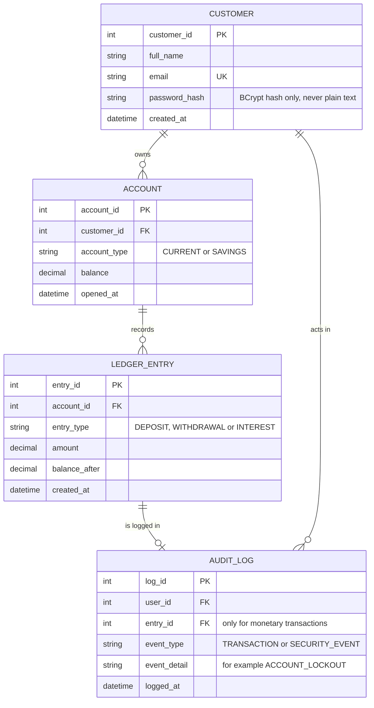

# Database Schema

This file describes the database of the Secure Banking Application: the tables, their relationships and the integrity rules that support SR-2.1 to SR-2.3 and the audit trail requirement in section 5.4 of the SRS. Money values are stored as DECIMAL(12,2), never as floating point.

## ER Diagram

## Integrity Rules

1. Primary keys: customer_id, account_id, entry_id and log_id are the primary keys of their tables. CUSTOMER.email is UNIQUE and NOT NULL.
2. Foreign keys: ACCOUNT.customer_id references CUSTOMER.customer_id. LEDGER_ENTRY.account_id references ACCOUNT.account_id. AUDIT_LOG.user_id references CUSTOMER.customer_id. AUDIT_LOG.entry_id references LEDGER_ENTRY.entry_id and is filled only for monetary transactions. No account can exist without a customer.
3. Account type: ACCOUNT.account_type must be CURRENT or SAVINGS (CHECK constraint).
4. Current Account balance: balance >= -500.00 (SR-2.1, L_max).
5. Savings Account balance: balance >= 100.00 (SR-2.3, B_min). Savings Accounts never have an overdraft.
6. Amount: LEDGER_ENTRY.amount > 0.00.
7. Password storage: CUSTOMER stores only the BCrypt password hash, never the password.
8. Append-only: LEDGER_ENTRY and AUDIT_LOG rows can only be inserted and read. UPDATE and DELETE are not allowed. A correction is made by appending a new entry.
9. Audit entries: every AUDIT_LOG row has a timestamp set by the database and a User ID (both NOT NULL). One entry is written for every monetary transaction and every security event, such as an account lockout (SRS section 5.4).
